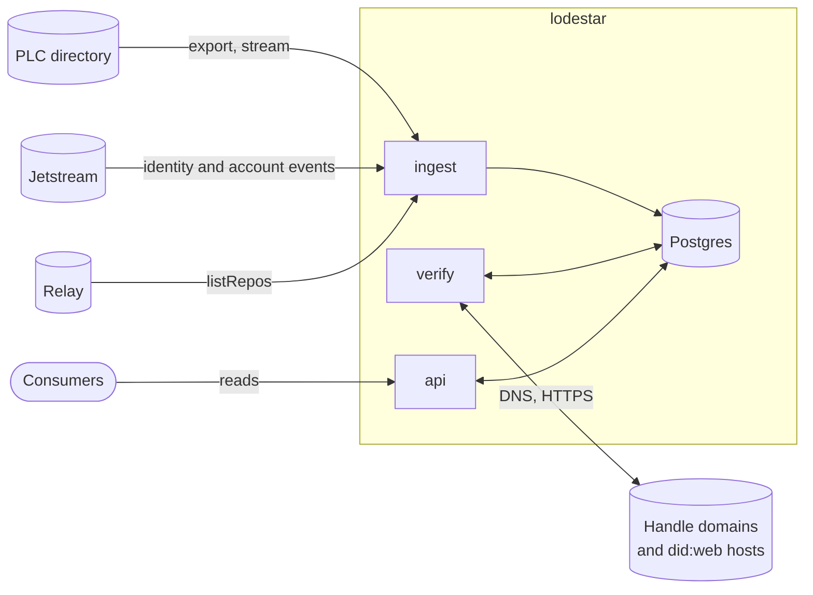

# Architecture

Lodestar is one binary with three roles. Each role runs as its own
process, normally its own container, and they share one Postgres
database. All coordination between roles goes through that database,
so the roles never talk to each other directly and need not run on the
same machine.

## The roles

| Role | Command | Talks to | Does |
|---|---|---|---|
| Ingest | `lodestar ingest` | the PLC directory, Jetstream, a relay | Keeps the copy of the directory, discovers `did:web` accounts, marks which identities have a repo, and queues work for verification. |
| Verification | `lodestar verify` | any host a handle or `did:web` names | Checks handles, fetches `did:web` documents, runs the weekly sweep, and keeps the pauses that protect it. The only role that contacts arbitrary hosts. |
| API | `lodestar api` | nothing outside | Serves reads, and the status page if it is turned on. Makes no outbound requests and needs no outbound network access. |

Keeping outbound requests to arbitrary hosts in one role means every
rate limit and every address check is applied in one place. It also
means the API role can run with no outbound network at all.

There is one verification role. Its rate limits are kept in its own
memory, so running two would double every limit; more than one would
need a shared limiter, which is not built.

### Ingest

Ingest runs four tasks side by side, each with its own database
connection:

- the **PLC source**, which pages the directory's export and then
  follows its stream ([Sources](sources.md#the-plc-directory));
- one **Jetstream subscription** per configured instance, two by
  default ([Sources](sources.md#jetstream));
- the **relay walk**, which lists every repo a relay knows about once a
  week ([Sources](sources.md#the-relay-walk));
- the **document pass**, a one-off job that fills in DID document parts
  for a copy made before lodestar kept them
  ([Sources](sources.md#the-document-pass)). Once done it does nothing.

If any one of these ends, for any reason, the whole role stops, and its
supervisor (compose, by default) restarts it. Every source commits its
position in the same transaction as the data it covers, so a restart
picks up exactly where the last commit left off.

### Verification

The verification role runs the handle checker, the `did:web` fetcher,
the weekly laps and the large-domain walkers, the control checks, and
the domain pauses. It drains two queues the other roles write:
`verify_due`, the work to do ahead of the sweep, and
`resolve_requests`, the live lookups the API is waiting on. It writes a
short report of its state (`role_status`) that the API serves in
health. See [Handle verification](handle-verification.md).

### API

The API role serves the reads described in [API](api.md). When a read
needs something lodestar does not have yet, such as an unseen `did:web`
or a handle that is not in the index, it writes a `resolve_requests`
row, waits up to a deadline for the verification role to answer it, and
replies. If the status page is turned on it is served from the same
process, on an address of its own.

## How the roles coordinate

| Table | Written by | Read by | For |
|---|---|---|---|
| `verify_due` | ingest, api, verify | verify | Work to do ahead of the sweep, by priority |
| `resolve_requests` | api, verify | api, verify | A live lookup the API is waiting on, and its answer |
| `sync_state` | ingest, verify | every role | Each source's position and phase, each lap's position, the pauses |
| `role_status` | verify | api | The verification role's own report, for health |

Everything else is data: what lodestar knows about each identity. See
[Data model](data-model.md).

## Start-up order

From an empty database:

1. **The PLC source** pages the directory's export from the start. This
   is the first sync, about 9 hours on the reference host, paced by the
   directory. Jetstream subscriptions run from the start too, and
   `did:web` documents they discover are fetched as they come.
2. **At the directory's tip**, the PLC source rebuilds the `accounts`
   primary key (a key filled row by row ends much larger than one built
   in a single pass), compacts its recovery-window table, refreshes the
   planner's statistics, switches to the stream, and from then on queues
   every claim change for verification.
3. **The relay walk** runs once the PLC source is live, and marks which
   identities have a repo.
4. **The verification role** counts handle claims once the PLC source is
   live, to find the shared handles. Until then it checks nothing.
5. **The laps** start once the walk has finished, so the first sweep can
   check listed identities first.

Until the PLC source has reached the tip, lodestar answers lookups for
`did:plc` identities it does not have yet with `syncing`, not
`not_found` ([API](api.md#freshness)).

## Schema

Every role creates the schema when it starts, under a database lock, and
every statement is safe to run again. There is no separate migration
step. The few changes made to tables after they were first created are
applied the same way, in place.

## Stopping

Each role stops on SIGINT or SIGTERM. Ingest finishes the transaction in
hand, so its cursors stay consistent. The API and status page finish the
requests in flight. Compose allows each role 40 seconds.

## Packaging

- One binary, `lodestar`, with one subcommand per role.
- One image, built for x86-64 today, with ARM64 planned.
- One compose file: Postgres 16, the three roles, and Caddy as the
  public face, which a host with a proxy of its own turns off
  ([Deployment](deployment.md#going-public)).
- Settings are command-line flags, and every setting an operator
  normally needs also has a `LODESTAR_` environment name; the
  [configuration](../configuration.md) lists those. A few switches
  meant for testing, such as `--no-jetstream` or `--plc-max-pages`, are
  flags only.

There are also three one-off commands, for operators:

| Command | Does |
|---|---|
| `lodestar init-db` | Creates the schema and exits. |
| `lodestar check-handle <handle>…` | Resolves handles and prints what each resolves to. Uses no database. |
| `lodestar check-account <did>…` | Checks the named accounts' handles now and stores the result. |

## Profiles

A profile is a named set of starting rates for the verification role.
`vps`, the default, is sized for the reference host. `hobbyist` is for a
small board or a shared machine: it keeps the starting rate of one check
a second per domain, and lowers how far a domain's rate can climb, the
largest provider's rate, the global rate, and every cap on requests in
flight. A profile changes only pace: on every profile every
identity is indexed, every handle verified and history kept. The numbers
are in [Handle verification](handle-verification.md#rates).
